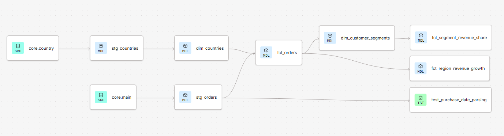

# Vantra dbt Pipeline

📊 **Business analysis:** Findings and recommendations → [**View the Vantra analysis**](https://github.com/bpananalytics/Vantra_Electronics_Analysis)

📋 **Roadmap and sprint tracking:** Follow my progress → [**Vantra project board**](https://github.com/users/bpananalytics/projects/1/views/1)

An analytics engineering pipeline re-built using **dbt** and **BigQuery**, transforming raw e-commerce order data into clean, tested, analysis-ready tables.

## Business Question

Which brands, regions, and customer segments drive revenue for Vantra Electronics, and how did that change after the 2020 peak?

## Data

- **Orders:** ~108,000 orders from an online electronics retailer, 2019–2022
- **Country lookup:** country code → sales region mapping (countries are identified by code only; no country names in the source)

## Pipeline

    core (raw)  →  staging  →  marts  →  analysis

| Layer | Models | Purpose |
|---|---|---|
| Raw | `core.main`, `core.country` | Untouched uploads |
| Staging | `stg_orders`, `stg_countries` | Clean and standardize each source (built as views) |
| Marts | `dim_countries`, `fct_orders`, `fct_region_revenue_growth`, `dim_customer_segments`, `fct_segment_revenue_share` | Business-ready tables for reporting (built as tables) |

Every model, column, and source is documented in dbt, and the lineage graph above is generated from the code itself.

### Marts

- **`dim_countries`**: one row per country code, mapped to a sales region (APAC, EMEA, LATAM, NA).
- **`fct_orders`**: one row per order and refund date, enriched with region from `dim_countries`. Intentionally wide (BigQuery is columnar, so wide tables are cheap to query); countries are split into their own dimension because region mapping needed its own cleanup and tests.
- **`fct_region_revenue_growth`**: one row per region per quarter (2019-Q1 to 2022-Q4) with revenue and quarter-over-quarter growth. Growth uses a window function (`LAG` partitioned by region), so each region is compared only to its own previous quarter; the first quarter per region has no prior quarter and is null.
- **`dim_customer_segments`**: one row per customer (87,540) with order count, total spend, last purchase date, and segment. Segments are a 2×2 of repeat vs. one-time buyer × last purchase in 2022 vs. before:

  | | Bought in 2022 | Last bought before 2022 |
  |---|---|---|
  | **Repeat (2+ orders)** | Loyal (3,399) | At Risk (13,835) |
  | **One-time** | New (15,109) | Lapsed (55,197) |

- **`fct_segment_revenue_share`**: one row per segment with customers, revenue, average spend, % of customers, % of revenue, and a revenue index (% of revenue ÷ % of customers; 1.0 = average, above 1 = each customer is worth more than average). Percentages are stored at full precision; rounding is left to the dashboard.

## Data Quality Issues Handled

**Staging**
- **Duplicates:** 96 exact duplicate rows removed
- **Mixed date formats:** `purchase_ts` contained `m/d/yyyy`, `m/d/yyyy h:mm`, and Excel serial numbers; all parsed to `DATE`
- **Product names:** 9 variants standardized to 8 products
- **Prices:** converted to `NUMERIC`; 158 $0 orders and 33 missing prices flagged
- **Corrupted IDs:** ~770 order IDs and ~600 user IDs were converted to scientific notation by Excel; unrecoverable, documented
- **Country lookup:** header row loaded as data removed; conflicting US duplicate resolved (placeholder 'x' dropped); 'North America' standardized to NA; missing regions filled for Benin (EMEA) and Bermuda (LATAM)
- **Revenue rule:** $0 and missing-price orders excluded from revenue and order counts; refunded orders kept (gross revenue)
- **Date checks:** 15 orders shipped before purchase are flagged (`is_ship_before_purchase`); no other date-order violations found
- **Refund tracking:** refunds stop being recorded after Aug 2021, so refund analysis is limited to earlier purchases
- **Product ID:** 58 IDs across 8 products, not tied to price, currency, or channel; dropped in favor of `product_name` as the product key
- **Brand:** derived from product name (Apple, Samsung, Lenovo, Bose; the monitor is labeled Generic)
- **Marketing channel:** 82 'unknown' values set to null; null = channel not recorded (1,469 rows)
- **Currency:** 54 nulls left as-is; analysis uses USD only
- **User IDs:** Excel-corrupted IDs are mostly consistent per customer (2 known collisions), so they're kept

**Marts**
- **Order grain:** 5 order IDs appear twice, differing only by refund date. Uniqueness is tested on `order_id` + `refund_date` rather than guessing which row is correct.
- **Non-country location codes:** a relationships test caught 22 orders coded `EU`, `AP`, or `A1`. These are IP-geolocation codes ("Europe," "Asia/Pacific," "anonymous proxy"), not countries. They are left without a region rather than assumed, and excluded from the relationships test.
- **Missing country codes:** 140 orders have no country code and no region.
- **Impact:** together, orders without a region are ~0.15% of all orders; they are kept in `fct_orders` (left join) so no orders are dropped.
- **Regional growth exclusions:** `fct_region_revenue_growth` excludes the 162 orders with no region and 3 orders with no purchase date. A row-count check caught the null dates: they formed their own "null quarter" groups, which would have sorted first in the growth calculation and skewed each region's first-quarter growth.
- **Customer-level dedup:** `dim_customer_segments` collapses orders to one row per order before aggregating, so the 5 orders that appear twice (differing only by refund date) count once in order count and spend. Refunded orders are kept (gross), consistent with the revenue rule.
- **Revenue reconciliation:** revenue reconciles to the cent ($28,078,739.20) from `fct_orders` through `dim_customer_segments` to `fct_segment_revenue_share` (see `analyses/segment_revenue_reconciliation.sql`).

## Testing

dbt tests run on every build:
- **Not null and uniqueness** on keys (`country_code` in `dim_countries`; `order_id` + `refund_date` combination in `fct_orders` via `dbt_utils`; `region` + `quarter` combination in `fct_region_revenue_growth`; `user_id` in `dim_customer_segments`; `segment` in `fct_segment_revenue_share`)
- **Accepted values** on region (APAC, EMEA, LATAM, NA) and on customer segment (loyal, at_risk, new_customer, lapsed) in both segment marts
- **Referential integrity:** every order's country code must exist in `dim_countries` (geolocation pseudo-codes excluded and documented)
- **Model contract** on `fct_orders`: column names and data types are enforced, so the table can't change shape silently
- **Unit test** on `stg_orders` date parsing: fake rows cover all three source formats (m/d/yyyy, m/d/yyyy h:mm, Excel serial) plus junk values

Known data gaps in staging are set to warn rather than fail.

**CI:** a dbt Cloud CI job was configured to run `dbt build` on every pull request into `main`, so no change merges without passing all tests ([see PR #27](https://github.com/bpananalytics/vantra_dbt/pull/27)).

## Key Decisions

- Flagged questionable rows instead of deleting them
- Documented unrecoverable IDs rather than imputing them
- Left unmappable locations without a region instead of inferring one
- Used a left join in `fct_orders` so every order is kept, even without a matching country
- Used `NUMERIC` for prices to avoid float rounding
- Documented data quirks (corrupted IDs, null reasons, non-country codes) in column descriptions, not just in code comments
- Fixed load issues in staging, leaving raw tables untouched
- Simplified RFM to a recency × repeat 2×2 after profiling showed 80% of customers ordered only once, so frequency and spend tiers added little signal
- Built staging as views and marts as tables: staging is intermediate, marts are what dashboards and analysis read

## Tools

dbt Cloud · BigQuery · dbt_utils · GitHub
