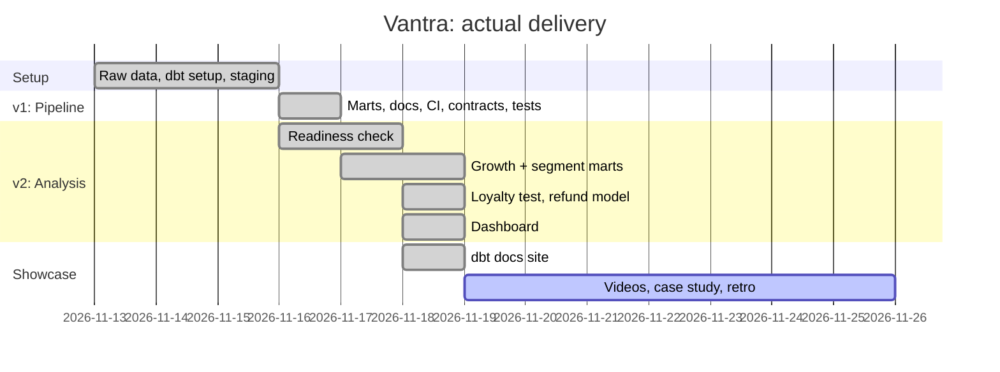

# Roadmap and Iterations

The project ran in three iterations. Target dates were set at the start of each iteration and revised once, after v1 finished early.

## Timeline: planned vs. actual

| Iteration | Scope | Planned | Actual |
|---|---|---|---|
| **Setup** | Load raw data, dbt project, staging layer | — | Nov 13–15 |
| **1. v1: Pipeline** | Marts, documentation, CI, contracts, unit tests | Thu Nov 19 (stop point Nov 29) | **Mon Nov 16** |
| **2. v2: Analysis** | Readiness check, growth and segment marts, loyalty test, refund model, dashboard | Sat Nov 21 | **Wed Nov 18** |
| **3. Showcase** | dbt docs site, walkthrough videos, case study, retrospective | Mon Nov 23 – Wed Nov 25 | In progress (docs site done Nov 18) |

## Iteration 1 review: v1 Pipeline

**Delivered:** `stg_countries` cleanup, `dim_countries`, `fct_orders`, model and column documentation, a dbt Cloud CI job on pull requests, a model contract on `fct_orders`, and unit tests for date parsing (#9, #11, #13, #14, #16, #18).

**Schedule:** finished in one day (~4.5 hours) against a Thursday target. The target had been set as a timebox rather than derived from an estimate, so it was too generous.

**Scope changes:** the scheduled nightly job (#19) was cut because the data is static. A duplicate documentation issue (#12) was closed.

**Carried forward:** not every data quality issue was resolved in v1, so a dedicated readiness check (#33) was added at the start of v2.

## Iteration 2 review: v2 Analysis

**Delivered:** readiness check with an agreed revenue rule (#33), `fct_region_revenue_growth` (#29), `dim_customer_segments` (#20), `fct_segment_revenue_share` (#30), loyalty significance test (#17), refund-risk classifier (#21), clustering on `fct_orders` (#15), and the Tableau dashboard (#31).

**Schedule:** estimated at 8–11.5 hours with a revised target of Sat Nov 21; finished Wed Nov 18 in roughly 12 hours, at the top of the estimate.

**Scope changes:** RFM was reduced to a 2×2 segmentation after profiling; the refund-risk classifier was added; date partitioning was dropped in favor of clustering; the BigQuery ML forecast (#22) was cut; the README findings issue (#32) was folded into the dashboard issue (#31). Details are in the [decision log](decision_log.md).

**Key results:**
- Revenue peaked at about $3M a quarter in late 2020, and every region followed the same surge-and-decline path.
- At Risk customers are 16% of customers but 31% of revenue.
- Loyalty members repeat *less* than non-members who started the same year, reversing the original analysis.
- Refund risk is concentrated in laptops, website orders, and loyalty members; the model doubles the hit rate but isn't precise enough for order-level action.

## Iteration 3: Showcase (in progress)

| Item | Status |
|---|---|
| dbt docs site on GitHub Pages (#39) | Done Nov 18 |
| Project management docs (#38) | Done |
| Walkthrough videos: findings and pipeline (#37) | To do |
| Long-form case study (#40) | To do |
